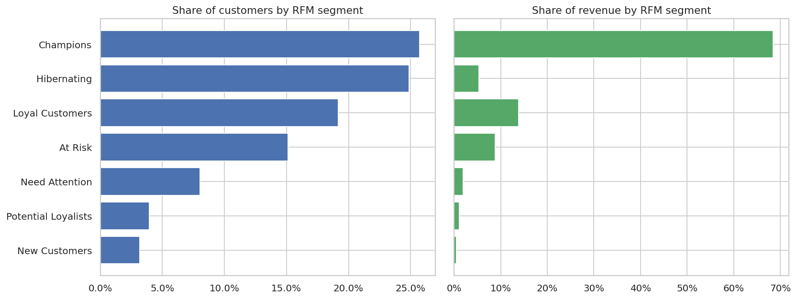

# Hi, I'm Ankireddy Bhaskar

Aspiring **Data Analyst**. I work with Python, pandas, SQL, scikit-learn and data visualisation.

## Featured project

### [E-commerce Customer Analytics](ecommerce-customer-analytics/)
End-to-end analysis of **541,909 real transactions** from a UK online retailer: data cleaning, KPI reporting,
sales trends, **cohort retention**, **RFM segmentation**, **K-Means clustering** and **market basket analysis**,
with business recommendations.

- Top 20% of customers generate **73.7%** of revenue
- "Champions" (26% of customers) bring in **68%** of revenue
- Sep to Nov brings in **~36%** of annual revenue
- Only **~20%** of new customers return the following month

**Tech:** Python · pandas · NumPy · scikit-learn · Matplotlib · seaborn · Jupyter · pytest · GitHub Actions
