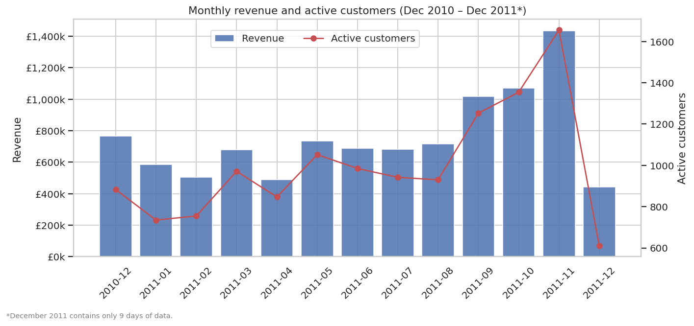
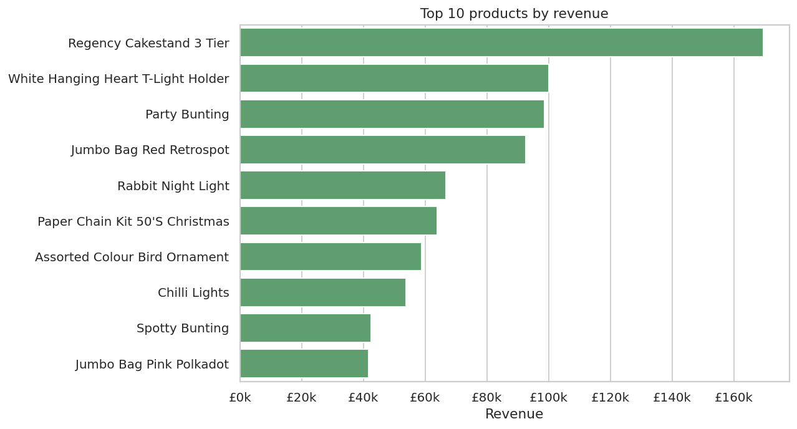
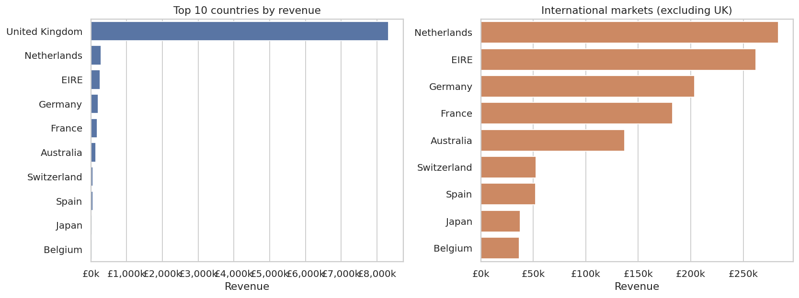
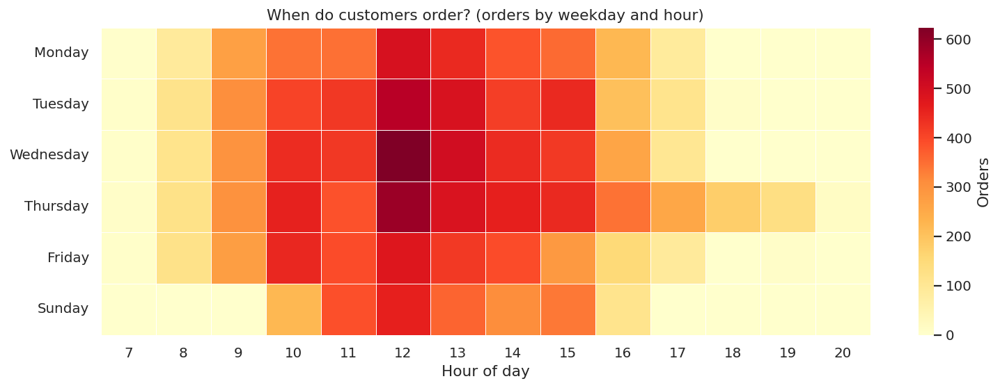
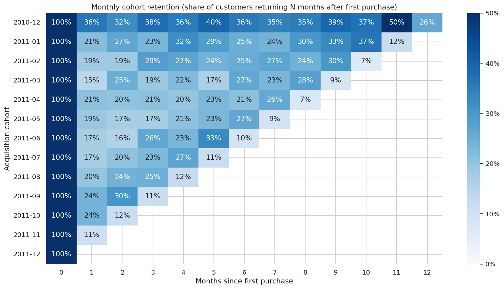
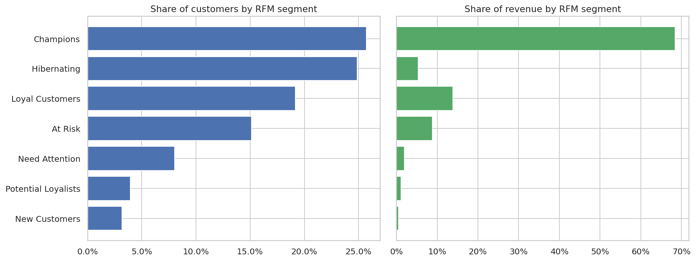
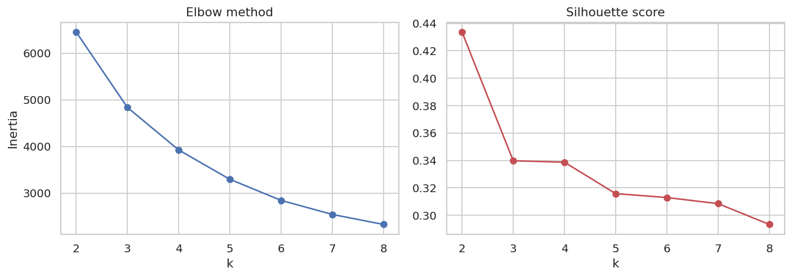
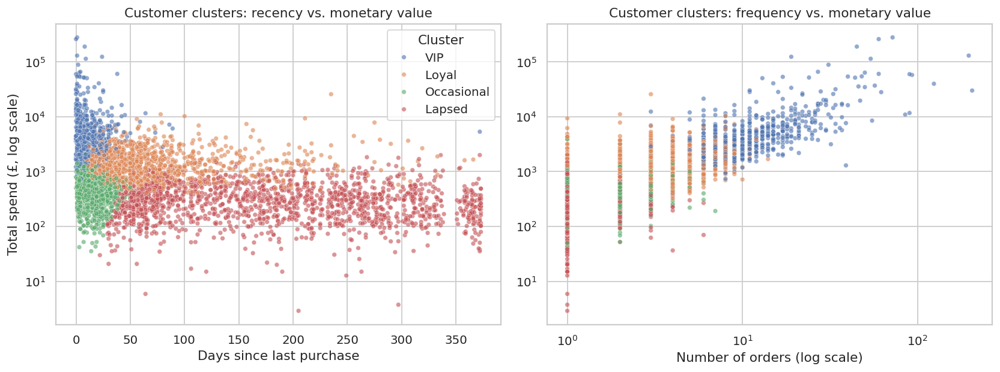

# E-commerce Customer Analytics


An end-to-end data analysis project on **541,909 real transactions** from a UK online gift retailer.
It covers data cleaning, KPI reporting, sales-trend analysis, **cohort retention**, **RFM customer
segmentation**, **K-Means clustering** and **market basket analysis**, and ends with recommendations
the business can act on.

> **Tech stack:** Python · pandas · NumPy · scikit-learn · Matplotlib · seaborn · Jupyter · pytest · GitHub Actions

---

## Business questions

1. How are revenue and customer activity trending?
2. Which products and markets drive the business?
3. When do customers place orders?
4. How well are newly acquired customers retained?
5. Who are the most valuable customers, and who is about to churn?
6. Which products are bought together?

## Dataset

[UCI Online Retail](https://archive.ics.uci.edu/dataset/352/online+retail) (CC BY 4.0) covers every
transaction of a UK-based, non-store online retailer between **01 Dec 2010 and 09 Dec 2011**. Many
customers are wholesalers. The data is downloaded automatically on first run (see [`data/README.md`](data/README.md)).

## Key results

| KPI | Value |
|---|---|
| Revenue (cleaned) | **£9.82M** |
| Orders | 19,612 |
| Customers | 4,322 |
| Products | 3,798 |
| Countries | 38 |
| Average order value | £500.58 |
| Repeat-customer rate | 65.3% |
| Revenue from top 20% of customers | **73.7%** |
| Average month-1 cohort retention | 20.4% |

### 1. Strong Q4 seasonality


Revenue stays flat through H1 2011, then climbs from September. **November 2011 (£1.44M) is 2.8× February**,
and Sep to Nov brings in **~36% of annual revenue**. The growth comes from more active customers,
not larger baskets, which points to wholesalers stocking up for Christmas.

### 2. Products and markets



The UK accounts for **~85% of revenue**. The Netherlands and EIRE each rely on a handful of very large
accounts (9 and 3 customers). **Germany (94 customers) and France (87)** have the broadest international customer bases.

### 3. Ordering behaviour


Orders peak at **12:00 to 13:00 on Tuesday to Thursday**. There are no Saturday orders and almost no
evening activity, a typical B2B pattern.

### 4. Cohort retention


Only **~20% of newly acquired customers return the next month**. The Dec-2010 cohort keeps 30% to 50%
of its customers every month; it most likely contains established customers who bought before the
dataset starts.

### 5. RFM segmentation


| Segment | Customers | % customers | % revenue | Avg recency (days) | Avg orders |
|---|---|---|---|---|---|
| Champions | 1,111 | 25.7% | **68.5%** | 12 | 10.0 |
| Loyal Customers | 828 | 19.2% | 13.8% | 37 | 3.6 |
| At Risk | 654 | 15.1% | 8.9% | 150 | 3.4 |
| Hibernating | 1,075 | 24.9% | 5.4% | 217 | 1.1 |
| Need Attention | 346 | 8.0% | 1.9% | 52 | 1.1 |
| Potential Loyalists | 171 | 4.0% | 1.1% | 18 | 1.4 |
| New Customers | 137 | 3.2% | 0.5% | 18 | 1.0 |

### 6. K-Means clustering



Clustering log-scaled, standardised RFM features with **k = 4** (chosen from the elbow and silhouette
plots) gives groups that line up with the rule-based segments:

| Cluster | Customers | Avg recency | Avg orders | Avg spend | % revenue |
|---|---|---|---|---|---|
| VIP | 680 | 11 days | 13.9 | £7,849 | **64.3%** |
| Loyal | 1,187 | 69 days | 4.1 | £1,658 | 23.7% |
| Occasional | 813 | 17 days | 2.2 | £552 | 5.4% |
| Lapsed | 1,642 | 180 days | 1.3 | £337 | 6.7% |

### 7. Market basket analysis
Colour and pattern variants of the same product sell together. Examples: *Green & Roses Regency
Teacup and Saucer* (lift 14.0), *Jumbo Bag Pink Polkadot & Red Retrospot* (lift 6.4), *Alarm Clock
Bakelike Green & Red* (lift 12.3). Full table: [`reports/tables/product_pairs.csv`](reports/tables/product_pairs.csv).

## Recommendations

1. **Protect Champions/VIPs** (26% of customers → 68% of revenue) with account management, early access to seasonal ranges and volume pricing.
2. **Win back At-Risk customers**: 654 formerly frequent buyers, about £736k in historical revenue, inactive for ~150 days.
3. **Improve second-purchase onboarding**, since only ~20% of new customers return in month 1.
4. **Plan inventory, staffing and marketing around the Sep to Nov peak.**
5. **Bundle and cross-sell product variants** ("complete the set", "frequently bought together").
6. **Send campaigns on weekday late mornings** and grow the Germany and France customer bases.

## Project structure

```
ecommerce-customer-analytics/
├── data/                          # raw data (downloaded on first run, git-ignored)
├── notebooks/
│   └── ecommerce_customer_analytics.ipynb   # full narrative analysis with outputs
├── reports/
│   ├── figures/                   # generated charts
│   └── tables/                    # generated CSV summaries
├── src/retail_analysis/
│   ├── data.py                    # download, load, clean
│   ├── metrics.py                 # KPIs, trends, products, countries, Pareto
│   ├── cohort.py                  # cohort retention matrix
│   ├── rfm.py                     # RFM scoring, segments, K-Means
│   ├── basket.py                  # product-pair association rules
│   ├── plots.py                   # chart helpers
│   └── pipeline.py                # end-to-end script
├── tests/                         # pytest unit tests
├── Makefile
└── requirements.txt
```

## How to run

```bash
git clone https://github.com/AnkireddyBhaskar/AnkireddyBhaskar.git
cd AnkireddyBhaskar/ecommerce-customer-analytics
pip install -r requirements.txt

# regenerate all figures and tables (downloads the dataset on first run)
make analysis        # or: cd src && python -m retail_analysis.pipeline

# explore the narrative notebook
make notebook

# run the tests
make test
```

## Methodology notes

- **Cleaning:** removes exact duplicates, cancellations **and the original order lines they reverse**
  (same customer, product and quantity), non-positive quantities/prices, and non-product lines
  (postage, bank charges, manual adjustments). About 4.1% of rows are removed.
- **Guest checkouts** (rows without `CustomerID`, ~25%) count toward sales metrics but are excluded from customer-level analysis.
- **RFM:** recency is measured from the day after the last invoice. Scores are quintiles (1 to 5), and
  segments are assigned from the R and F scores.
- **Clustering:** log1p transform → standardisation → K-Means (`n_init=10`, `random_state=42`). Cluster
  labels are sorted by average spend so they stay the same between runs.
- **Market basket:** pairs must reach at least 1% support and a lift of at least 3, and are ranked by support.

## License

Code is released under the [MIT License](LICENSE). Dataset © UCI Machine Learning Repository, CC BY 4.0.
